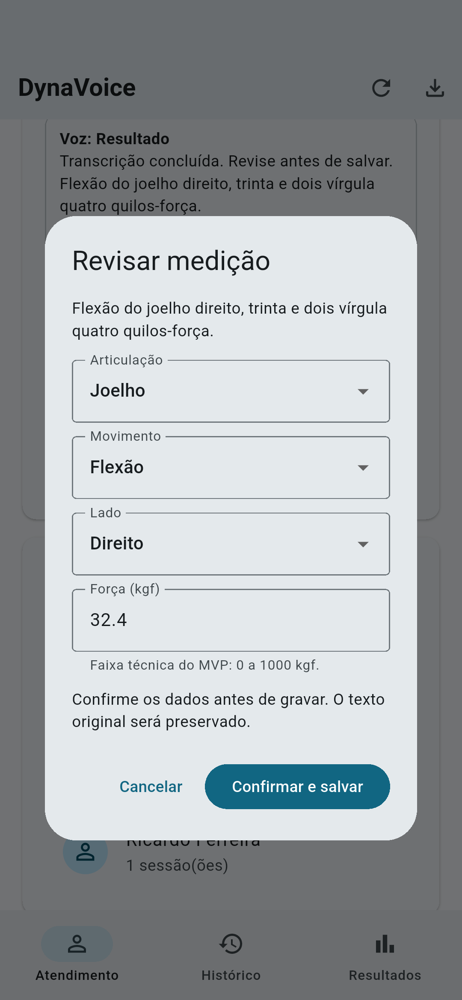
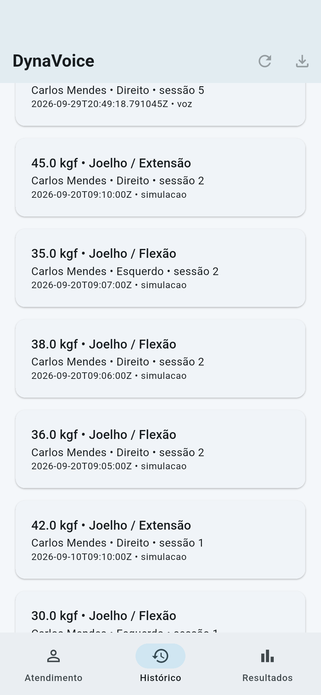

UNIVERSIDADE ESTADUAL DO MARANHÃO

Curso Superior de Tecnologia em Análise e Desenvolvimento de Sistemas - Gestão da Qualidade e Teste de Software

Anderson Silva da Cunha - Igor Eduardo da Silva Souza

DYNAVOICE: IMPLEMENTAÇÃO FUNCIONAL, TESTES E LIMITES DO MVP

Evolução do MVP acadêmico - Axixá - 2026

## 1 INTRODUÇÃO

O DynaVoice é uma proposta acadêmica de aplicativo Android para organizar registros fictícios de força obtidos por dinamometria. A ideia original definiu captura de voz, interpretação de comandos, revisão dos dados, persistência e exportação, além da hierarquia Paciente, Sessão, Avaliação e Medição. Nesta evolução, integrei o reconhecimento de fala em português brasileiro ao fluxo que já usava SQLite, mantendo a revisão humana obrigatória antes da gravação.

## 2 DESCRIÇÃO DO PROTÓTIPO/MVP

A versão anterior já cadastrava pacientes, mantinha sessões e persistia medições, mas a voz ainda era simulada por uma frase predefinida. A implementação atual usa o reconhecedor disponível no Android, solicita a permissão do microfone, configura o idioma pt-BR e apresenta os estados de permissão, pronto, ouvindo, processando, resultado, cancelamento, indisponibilidade e erro. A entrada manual permanece disponível.

O mecanismo de fala fica atrás de uma interface própria. Nos testes automatizados, uma implementação falsa reproduz resultados parciais e definitivos sem depender do microfone. No aplicativo, a implementação real encaminha a transcrição ao parser e abre a revisão editável. Somente a confirmação grava no SQLite. Todos os dados usados nas evidências são fictícios.


<!-- quebra de página -->

## 3 DESENVOLVIMENTO DA SOLUÇÃO

A aplicação foi organizada em interface, serviço de reconhecimento de fala, parser, repositório SQLite e serviço de exportação. O código original foi preservado em docs/ para comparação. A interface SpeechRecognitionService separa a captura de voz da tela e permite trocar o mecanismo no futuro. O esquema SQL distribuído com o aplicativo é o mesmo empregado na verificação independente.

| Entidade | Responsabilidade e integridade |
| --- | --- |
| Paciente | PK id; nome obrigatório com 2 a 120 caracteres; data de criação válida. |
| Sessão | PK id; FK paciente_id; início obrigatório; encerramento não anterior ao início. |
| Avaliação | PK id; FK sessao_id; articulação e movimento controlados; UNIQUE por sessão, articulação e movimento. |
| Medição | PK id; FK avaliacao_id; lado e origem manual/voz controlados; força numérica; horário e transcrição original preservados. |

Relacionamentos: Paciente 1:N Sessão; Sessão 1:N Avaliação; Avaliação 1:N Medição. Articulação e movimento ficam na avaliação, evitando sua repetição nas medições. Cada tentativa registra lado e força. A exclusão de um paciente exige confirmação na interface e propaga-se às entidades dependentes por ON DELETE CASCADE.

```sql
PRAGMA foreign_keys = ON;
CREATE TABLE medicao (
 id INTEGER PRIMARY KEY,
 avaliacao_id INTEGER NOT NULL
   REFERENCES avaliacao(id) ON DELETE CASCADE,
 lado TEXT NOT NULL CHECK(lado IN ('Direito','Esquerdo')),
 forca_kgf REAL NOT NULL CHECK(
   typeof(forca_kgf) IN ('integer','real')
   AND forca_kgf >= 0 AND forca_kgf <= 1000),
 ...
);
```

Trecho abreviado; o script completo é sql/01_schema.sql. A faixa de 0 a 1000 kgf é uma regra técnica do MVP, não um limite clínico validado. A migração v1 para v2 preserva registros anteriores e acrescenta a origem voz. A gravação da avaliação e da medição ocorre em transação, e o repositório rejeita novas medições em sessões encerradas.


<!-- quebra de página -->

## 3.1 DADOS DE TESTE E CONSULTAS SQL

O script sql/02_dados_teste.sql insere 3 pacientes fictícios, 4 sessões, 6 avaliações e 12 medições. Carlos Mendes possui duas sessões comparáveis; Ana Beatriz e Ricardo Ferreira permitem verificar separação por paciente. O carregamento de demonstração na interface só é permitido em banco vazio.

| Consulta | Informação produzida |
| --- | --- |
| Q1 | Histórico com paciente, sessão, articulação, movimento, lado, força, horário e origem. |
| Q2 | Quantidade de tentativas, média e pico por avaliação e lado. |
| Q3 | Evolução do pico de flexão do joelho direito do paciente 1. |
| Q4 | Quantidade de sessões por paciente, incluindo pacientes sem sessão por LEFT JOIN. |
| Q5 | Picos direito e esquerdo por avaliação; ausência de lado resulta em NULL. |

```sql
SELECT s.iniciada_em, MAX(m.forca_kgf) AS pico_kgf
FROM medicao m
JOIN avaliacao a ON a.id=m.avaliacao_id
JOIN sessao s ON s.id=a.sessao_id
WHERE s.paciente_id=1 AND a.articulacao='Joelho'
 AND a.movimento='Flexão' AND m.lado='Direito'
GROUP BY s.id ORDER BY s.iniciada_em;
```

| Resultado verificado | Valor obtido |
| --- | --- |
| Média da flexão direita, primeira sessão | 33,2 kgf (32,4 e 34,0; duas tentativas) |
| Pico em 10/09/2026 | 34,0 kgf |
| Pico em 20/09/2026 | 38,0 kgf |

Fonte: execução de sql/03_consultas.sql sobre o banco fictício. Os resultados completos estão em evidencias/consulta_1.csv a consulta_5.csv. A diferença entre os picos é descritiva e não demonstra evolução clínica real.


<!-- quebra de página -->

## 4 TESTES E VALIDAÇÃO

A validação combinou 24 verificações independentes em SQLite/Python, 35 testes automatizados Dart/Flutter e um teste de integração Android. O analisador estático terminou sem problemas e o APK de depuração foi gerado. O ambiente utilizou Flutter 3.44.8, Dart 3.12.2 e emulador Pixel 8 com Android 14. Os registros de execução estão na pasta evidencias/.

| Procedimento / resultado esperado | Resultado obtido |
| --- | --- |
| Criar esquema e inserir o conjunto fictício. | 3 pacientes, 4 sessões, 6 avaliações e 12 medições; integridade do banco: ok. |
| Tentar PK duplicada, FK inexistente, nome nulo/vazio, lado inválido e força negativa/textual. | Operações rejeitadas; conjunto válido preservado. |
| Gravar, fechar e reabrir o banco. | Medições e sessões abertas recuperadas. |
| Forçar falha na inserção após criar a avaliação. | Transação revertida; avaliação parcial não permaneceu. |
| Interpretar 32,4; números por extenso; decimal com zero inicial. | Valores esperados reconhecidos; ausência de força distinguida de zero. |
| Interpretar kgf, kg, quilo, quilos e quilos-força em ordens diferentes. | A frase de referência produziu Joelho, Flexão, Direito e 32,4 kgf; ambiguidades permaneceram para revisão. |
| Revisar, corrigir a força e confirmar; cancelar voz e revisão. | Uma confirmação gerou uma medição de origem voz; cancelamentos não geraram medição. |
| Exportar JSON do paciente 1. | Arquivo legível com IDs e horários originais; dados de outros pacientes excluídos. |
| Executar fluxo Android e reabrir banco nativo. | 12 registros iniciais; 13 após inclusão por voz falsa; 9 no JSON filtrado; registros recuperados após reabertura. |

Arquivos: flutter_analyze.txt, flutter_test.txt, testes_sql.txt, resultados_sql.json e integracao_android.txt. As contagens correspondem a verificações executadas, não a uma certificação de qualidade ou cobertura integral de caminhos.


<!-- quebra de página -->

## 5 FALHAS, BUGS E MELHORIAS

| Problema identificado | Correção ou tratamento |
| --- | --- |
| Histórico apenas em memória. | SQLite integrado; sessões abertas podem ser retomadas. |
| Timestamp alterado a cada exportação. | Horário capturado na criação do registro e preservado. |
| Ausência de valor interpretada como zero. | Valor ausente é nulo; revisão exige preenchimento válido. |
| Números negativos e pontuação mal interpretados. | Rejeição de negativos/entradas numéricas ambíguas; correção de pontuação e decimais por extenso. |
| Registro sem conferência e JSON apenas em janela. | Confirmação e edição antes da gravação; exportação para arquivo. |
| Voz simulada por exemplo fixo. | Serviço real via speech_to_text, pt-BR, estados explícitos e implementação falsa apenas nos testes. |
| Parser adivinhava a primeira entidade encontrada. | Entidades ou números ambíguos ficam vazios e exigem correção na revisão. |

## 6 EVIDÊNCIAS DA ATIVIDADE

Figura 1 - Transcrição encaminhada à revisão e histórico persistido no emulador Android. Fonte: capturas do teste de integração, 29 set. 2026.





Os scripts SQL, o banco de demonstração, os CSVs, as capturas e o vídeo curto acompanham o projeto. O código está publicado em https://github.com/IgorEduss/DynaVoice.


<!-- quebra de página -->

## 7 LIMITAÇÕES E MELHORIAS PROPOSTAS

O código usa o reconhecedor real do Android, mas o ambiente desta execução não apresentou aparelho físico conectado. Por isso, não registro como concluída a validação do microfone em aparelho real. O teste Android automatizado usa o serviço falso para ser reproduzível e não comprova a precisão do reconhecimento. A sobreposição teve envio e cancelamento verificados em testes, mas ainda precisa de validação manual entre aplicativos e versões Android.

O parser trabalha com vocabulário controlado e pode receber transcrições incorretas do sistema operacional. Ambiguidades e campos ausentes exigem correção humana. Não foram implementados autenticação, criptografia do banco, backup automático ou sincronização. O armazenamento local não comprova conformidade regulatória nem segurança suficiente para uso clínico. O protótipo deve permanecer em avaliação acadêmica com dados fictícios.

## 8 CONCLUSÃO

A evolução implementa o fluxo interno proposto: selecionar um paciente, iniciar a sessão, receber uma transcrição pt-BR, interpretar os campos, revisar e somente então persistir. Histórico, estatísticas e exportação passam a refletir a medição confirmada. Os testes cobrem o parser, o serviço falso, o SQLite, o fluxo de interface e a integração Android. O MVP permanece acadêmico: a execução reproduzível foi comprovada no emulador, enquanto a captura em aparelho físico continua como limitação documentada.

## REFERÊNCIAS

CUNHA, Anderson Silva da; SOUZA, Igor Eduardo da Silva. DynaVoice: análise da qualidade da proposta tecnológica para registro de aferições de força por voz. Axixá: UEMA, 2026. Relatório técnico da Nota 1.

SQLITE. Foreign Key Support. Disponível em: https://www.sqlite.org/foreignkeys.html. Acesso em: 25 set. 2026.

TEKARTIK. sqflite: SQLite plugin for Flutter. Disponível em: https://pub.dev/packages/sqflite. Acesso em: 25 set. 2026.

FLUTTER. Integration testing. Disponível em: https://docs.flutter.dev/testing/integration-tests. Acesso em: 25 set. 2026.

CS DAVIS. speech_to_text: reconhecimento de fala para Flutter. Disponível em: https://pub.dev/packages/speech_to_text. Acesso em: 29 set. 2026.
